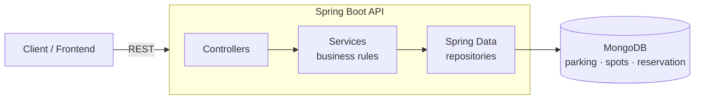
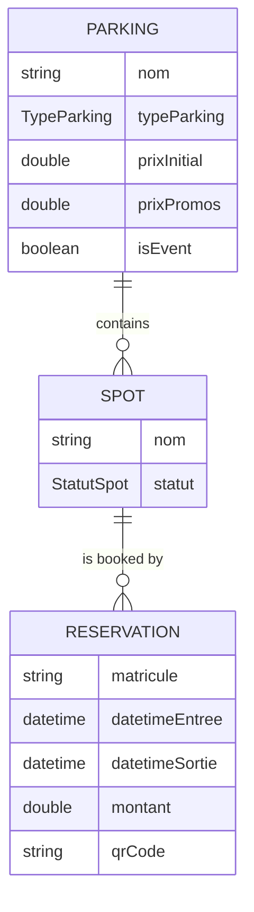

# 🅿️ Gestion Parking — Smart Parking Reservation API

REST API for managing parkings, parking spots and time-slot reservations, built with **Spring Boot** and **MongoDB**, containerized and ready for **Kubernetes**.
It is the parking module of a larger cloud-based attraction park management platform.


## Features

- **Parkings** by vehicle type (`VOITURE`, `MOTO`, `CAMION`, `BUS`, `VOITURE_HANDICAPE`), with promotional pricing periods and event parkings
- **Spots** with live status (`LIBRE`, `RESERVE`, `MAINTENANCE`) and "available spots per parking" query
- **Reservations** with:
  - **overlap detection** — a spot cannot be booked twice for intersecting time slots
  - **automatic price calculation** from entry/exit time (minimum 1 hour)
  - a unique **QR-code token** generated per reservation
  - lookup by spot or by **licence plate**
- **Soft delete** (`isDeleted`) and audit timestamps on every document
- **OpenAPI / Swagger UI** documentation
- Startup **database connectivity check** that logs the available collections

## Architecture





## API

| Method | Endpoint | Description |
|---|---|---|
| GET / POST | `/api/parkings` | List / create parkings |
| GET / PUT / DELETE | `/api/parkings/{id}` | Read / update / soft-delete a parking |
| GET | `/api/parkings/promotions` | Parkings with an active promotion |
| GET / POST | `/api/spots` | List / create spots |
| GET / PUT / DELETE | `/api/spots/{id}` | Read / update / delete a spot |
| PATCH | `/api/spots/{id}/status` | Change a spot's status |
| GET | `/api/spots/parking/{parkingId}` | Spots of a parking |
| GET | `/api/spots/parking/{parkingId}/available` | Free spots of a parking |
| GET / POST | `/api/reservations` | List / create reservations (conflict check + pricing) |
| GET / DELETE | `/api/reservations/{id}` | Read / cancel a reservation |
| GET | `/api/reservations/spot/{spotId}` | Reservations of a spot |
| GET | `/api/reservations/vehicle/{matricule}` | Reservations of a vehicle |

Interactive documentation: **http://localhost:8080/swagger-ui.html**

## Run it

### With Docker Compose (recommended)

```bash
docker compose up -d --build                    # API + MongoDB
docker compose --profile debug up -d            # + Mongo Express on :8081
```

### On Kubernetes

```bash
kubectl apply -f k8s/mongo.yaml    # MongoDB StatefulSet + persistent volume
kubectl apply -f k8s/api.yaml      # API Deployment (2 replicas, rolling update) + Service
kubectl port-forward svc/parking-api 8080:80
```

### Locally

```bash
docker run -d -p 27017:27017 mongo:7
./mvnw spring-boot:run
```

## CI

GitHub Actions builds and tests the project against a real MongoDB service container, builds the Docker image and scans it with **Trivy** (pipeline fails on fixable HIGH/CRITICAL vulnerabilities).

## Tech stack

Java 17 · Spring Boot 4 · Spring Data MongoDB · Lombok · springdoc-openapi · Maven · Docker (multi-stage, non-root) · Docker Compose · Kubernetes · GitHub Actions · Trivy

---
**Malek Ayadi** · [LinkedIn](https://www.linkedin.com/in/malek-ayadi) · [GitHub](https://github.com/malekayadi79)
